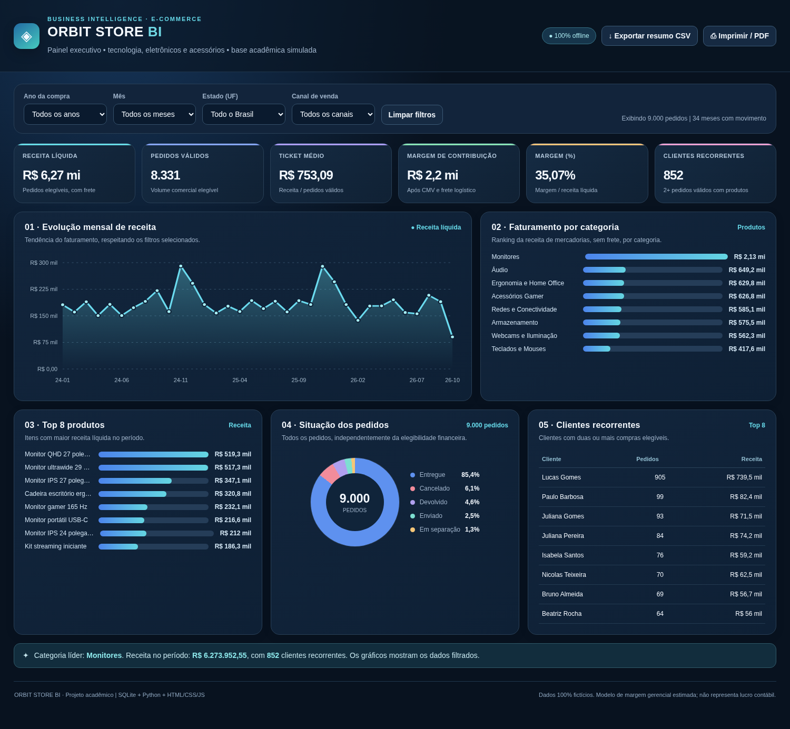

# Orbit Store BI — Projeto Acadêmico

**Business Intelligence de um e-commerce fictício de tecnologia e acessórios**, desenvolvido com três camadas: armazenamento de dados, processamento em Python e dashboard web.




> **Dashboard interativo:** https://tharibbeiro.github.io/PROJ_IMPACTA_ORBIT_STORE_BI/. 

## Arquitetura

```text
Dados originais (10 arquivos CSV)
            ↓
Python · ETL com pandas e numpy
            ↓
Dados analíticos (11 arquivos CSV)
            ↓
SQLite · tabelas raw_*, analytics_* e views
            ↓
Python · exportação de dados do SQLite
            ↓
HTML + CSS + JavaScript · dashboard único (index.html)
```

Para preservar a separação lógica dos dados, os nomes das tabelas usam prefixos `raw_` e `analytics_`. O HTML contém uma exportação dos dados necessários e **não exige conexão ativa com o SQLite** para ser visualizado.

## Estrutura do repositório

```text
PROJ_IMPACTA_ORBIT_STORE_BI/
├── backend/
│   ├── processar_metricas.py      # ETL e regras de negócio
│   ├── criar_banco_sqlite.py      # Criação das tabelas e views
│   ├── gerar_dashboard.py         # Geração do HTML a partir do SQLite
│   ├── validar_projeto.py         # Testes de integridade
│   └── requirements.txt
├── data/
│   ├── brutos/                  # 10 bases sintéticas de origem
│   └── tratados/                # 11 tabelas analíticas processadas
├── sql/
│   ├── orbit_store.sqlite       # Banco relacional pronto
│   └── consultas.sql            # Consultas de validação e exploração
├── dashboard/
│   ├── modelo_dashboard.html    # Front-end em HTML/CSS/JS
│   └── preview_dashboard.png
├── index.html                  # Dashboard pronto
└── README.md
```

## Etapas do desenvolvimento

**1. Banco de dados:** geração e organização de dados fictícios de clientes, produtos, categorias, pedidos, itens, pagamentos, campanhas, entregas, devoluções e tráfego. A camada relacional SQLite contém **10 tabelas originais, 11 tabelas analíticas e 4 views**.

**2. Back-end (Python):** tratamento de datas e textos, união de pedidos com pagamentos e entregas, cálculo de elegibilidade financeira, devoluções, receita líquida, custo de mercadorias (CMV), margem de contribuição, indicadores mensais e classificação RFM dos clientes. Os resultados são exportados para tabelas analíticas e carregados no banco.

**3. Front-end (dashboard):** uma única página com cartões de indicadores e gráficos, utilizando HTML, CSS e JavaScript. Os filtros de **ano, mês, UF e canal de venda** atualizam os resultados sem conexão com servidor externo.

## Indicadores apresentados

| Indicador | Resultado da base completa |
|---|---:|
| Clientes cadastrados | 1.200 |
| Produtos cadastrados | 64 |
| Pedidos totais | 9.000 |
| Pedidos financeiramente válidos | 8.331 |
| Receita líquida, incluindo frete | R$ 6.273.952,55 |
| Margem de contribuição estimada | R$ 2.200.130,29 |
| Margem de contribuição (%) | 35,07% |
| Ticket médio de pedidos válidos | R$ 753,09 |

O painel apresenta **evolução mensal da receita, faturamento por categoria, produtos mais vendidos, situação dos pedidos e clientes recorrentes**.

**Regras de análise:** receita de produtos/categorias não inclui frete; receita líquida consolidada inclui receita de frete. Margem de contribuição é uma métrica gerencial estimada (receita menos CMV e frete logístico), não lucro contábil. As análises cobrem janeiro de 2024 a **25 de outubro de 2026**, portanto o último mês está incompleto.

## Tecnologias

**SQLite · Python · Pandas · NumPy · HTML5 · CSS3 · JavaScript**.

*Todos os dados são sintéticos e foram gerados exclusivamente para fins acadêmicos.*
